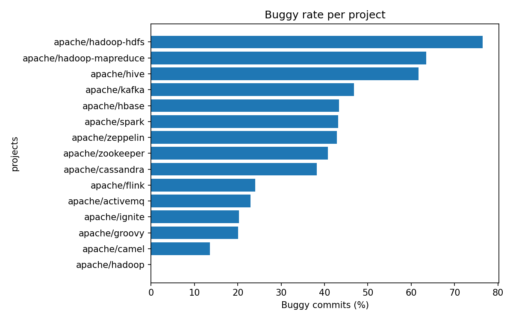

# apachejit-defect-prediction

Just-in-time (JIT) defect prediction on the ApacheJIT dataset: predicting whether a commit will introduce a bug, using CatBoost, with SHAP explanations.

---

## 1. Goal

This project predicts which code changes (commits) are likely to introduce bugs, using the public ApacheJIT dataset, CatBoost and SHAP. A risky commit gets flagged right when it's made, making it cheaper to fix the bug than after release. SHAP shows why a commit was flagged, for example "many lines added" or "inexperienced author", which makes a prediction more trustworthy for a developer.

---

## 2. Dataset

- **Name:** ApacheJIT
- **Source:** https://github.com/hosseinkshvrz/apachejit (`dataset/apachejit_total.csv`)
- **Paper:** H. Keshavarz and M. Nagappan, "ApacheJIT: A Large Dataset for Just-In-Time Defect Prediction," *MSR 2022*.

### 2.1 Quick facts

| Fact | Value |
|---|---|
| Number of commits (rows) | 106,674 |
| Number of columns | 18 |
| Number of project values | 15 |
| Date range | 2003-09-11 to 2019-12-26 |
| Buggy commits | 26.47 % |
| Clean commits | 73.53 % |
| Missing values | 0 |
| Duplicate `commit_id`s | 0 |
| Sorted by date? | ___ |

**Notes:**
- Hadoop is split into 3 values: `hadoop` (11,964), `hadoop-hdfs` (2,907) and `hadoop-mapreduce` (1,321), total: 16,192 commits, making it the second-largest project after Camel (22,700). 
- _Note on class imbalance and what it means for evaluation:_ ___

### 2.2 Columns

Role: **Label** = what we predict · **Feature** = model input · **Not used** = ID, grouping or time info only

| Column | Meaning (in my own words) | Type | Role |
|---|---|---|---|
| `commit_id` | Unique ID (hash) of the commit | text | Not used (ID) |
| `project` | Apache project the commit belongs to | text | Not used (grouping) |
| `buggy` | Whether this commit introduced a bug | bool | **Label** |
| `fix` | Whether this commit fixes a bug | bool | Feature |
| `year` | Year the commit was made | int | Not used (time) |
| `author_date` | Date and time the author made the commit (stored as a Unix timestamp; the notebook converts it to a date) | datetime | Not used (used for split) |
| `la` | Lines of code added | int | Feature |
| `ld` | Lines of code deleted | int | Feature |
| `nf` | Number of modified files | int | Feature |
| `nd` | Number of modified directories | int | Feature |
| `ns` | Number of modified subsystems | int | Feature |
| `ent` | Distribution of modified code across each file | float | Feature |
| `ndev` | Average of number of people worked in each of modified files | float | Feature |
| `age` | Average time interval between the last and the current change | float | Feature |
| `nuc` | Number of unique changes to the modified files | float | Feature |
| `aexp` | Developer experience | int | Feature |
| `arexp` | Recent Developer experience | float | Feature |
| `asexp` | Developer experience with a subsystem | float | Feature |

---

## 3. Exploratory Data Analysis

### 3.1 Buggy vs clean: medians

| Feature | Median (buggy) | Median (clean) | Buggy higher? |
|---|---|---|---|
| `la` | ___ | ___ | ___ |
| `ld` | ___ | ___ | ___ |
| `nf` | ___ | ___ | ___ |
| `nd` | ___ | ___ | ___ |
| `ns` | ___ | ___ | ___ |
| `ent` | ___ | ___ | ___ |
| `ndev` | ___ | ___ | ___ |
| `age` | ___ | ___ | ___ |
| `nuc` | ___ | ___ | ___ |
| `aexp` | ___ | ___ | ___ |
| `arexp` | ___ | ___ | ___ |
| `asexp` | ___ | ___ | ___ |

### 3.2 Plots

**Lines added (`la`), log scale**

_What it shows:_ ___

**Buggy rate per project**

_What it shows:_ ___

**Buggy rate per year**

_What it shows:_ ___

### 3.3 Key observations

1. ___
2. ___
3. ___

---

## 4. Method

### 4.1 Train / validation / test split

- **Type:** time-based (sorted by `author_date`, no shuffling)
- **Ratio:** ___ / ___ / ___

| Set | Rows | Date range | Buggy % |
|---|---|---|---|
| Train | ___ | ___ to ___ | ___ |
| Validation | ___ | ___ to ___ | ___ |
| Test | ___ | ___ to ___ | ___ |

_Why time-based and not random:_ ___

### 4.2 Preprocessing

- **Log transform:** ___ (which columns, and why)
- **Scaling:** ___ (fit on train only)
- **`fix` column:** ___
- **Class imbalance handling:** ___

### 4.3 Models

| Model | Key settings |
|---|---|
| Baseline: ___ | ___ |
| CatBoost | ___ |

### 4.4 Evaluation metrics

- Precision, Recall, F1, ROC-AUC, PR-AUC
- **PR-AUC of a random model** (= test-set buggy share): ___

---

## 5. Results

### 5.1 Test set

| Model | Precision | Recall | F1 | ROC-AUC | PR-AUC |
|---|---|---|---|---|---|
| Random (reference) | — | — | — | 0.50 | ___ |
| Baseline: ___ | ___ | ___ | ___ | ___ | ___ |
| CatBoost | ___ | ___ | ___ | ___ | ___ |

### 5.2 Cross-validation (time-series folds)

| Model | Mean F1 (± std) | Mean ROC-AUC (± std) | Mean PR-AUC (± std) |
|---|---|---|---|
| Baseline: ___ | ___ | ___ | ___ |
| CatBoost | ___ | ___ | ___ |

_Number of folds and how they were built:_ ___

---

## 6. Explainability (SHAP)

### 6.1 Global importance

_Top features and what they mean:_
1. ___
2. ___
3. ___

### 6.2 One example commit

_Why the model flagged this commit:_ ___

---

## 7. Limitations

- **Label latency:** ___
- ___
- ___

---

## 8. How to run

1. Open the notebook in Google Colab: [apachejit_defect_prediction.ipynb](apachejit_defect_prediction.ipynb)
2. Run all cells (Runtime → Run all). The dataset is downloaded automatically from GitHub.

**Main libraries:** pandas, scikit-learn, catboost, shap, matplotlib

---

## 9. References

1. H. Keshavarz and M. Nagappan, "ApacheJIT: A Large Dataset for Just-In-Time Defect Prediction," *Proc. MSR*, 2022.
2. Y. Kamei et al., "A Large-Scale Empirical Study of Just-in-Time Quality Assurance," *IEEE TSE*, 2013.
3. ___
